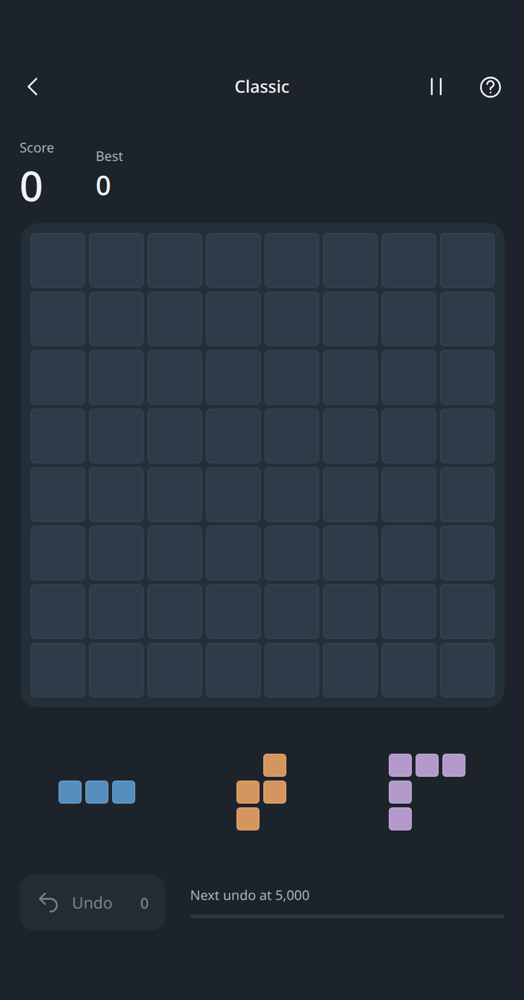

<p align="center">
  
</p>

# Blocks

**Make room for the next move.**

A block-placement puzzle for your browser. Fit pieces onto an 8 × 8 board, clear full rows and columns, and try to beat your best score.

**[Play in your browser](https://blocks-game.pages.dev/)** · [Development guide](docs/DEVELOPMENT.md) · [Verified release](docs/VERIFICATION.md)

<p align="center">
  
</p>

[](https://github.com/Listwas/blocks-game/actions/workflows/check.yml)

## Features

- Drag pieces into place, or select a piece and tap the board.
- Earn one undo at each new 5,000-point milestone, with one stored at a time.
- Every new tray has a verified sequence that fits all three pieces, including line clears. Your choices still matter.
- Save a run, come back later, and track your score, lines cleared, and playtime.
- Light, dark, and system themes; optional sound effects, volume control, and reduced motion.
- Works on phones, tablets, and desktop, with offline play after the first download.
- No ads, accounts, analytics, or music downloads.

## How to play

1. Place a piece from the tray onto empty squares. Pieces keep their orientation.
2. Fill a complete row or column to clear it and make space.
3. Place all three pieces to receive a new tray.
4. The run ends when no remaining piece fits and you cannot undo.

**Keyboard:** Tab to a tray piece and press Enter or Space to select it. Use the arrow keys to position it on the board, then Enter or Space to place it. Escape cancels a selection or opens Pause.

The in-game **How to play** includes short interactive examples. **Pause** lets you resume, start over, or return home.

## Install and play offline

Open [the game](https://blocks-game.pages.dev/) and wait for **Ready offline** before disconnecting.

- **iPhone / iPad:** Open in Safari, then choose Share → Add to Home Screen.
- **Android:** Use your browser's Install app or Add to Home screen option.
- **Desktop:** Play in a tab, or install through a browser that supports web apps.

The fullscreen button requests immersive mode where the browser supports it. iOS may keep the time and battery indicators visible.

Progress and statistics stay in the current browser or installed app. There is no account or cloud sync. Clearing site data removes your saves, and browser tabs may have separate storage from an installed iOS app. When **Refresh app** appears, it saves before applying the update.

## Run locally

Requires **Node.js 22+** and npm.

```sh
git clone https://github.com/Listwas/blocks-game.git
cd blocks-game
npm ci
npm run dev
```

Open the local address printed by Vite. For a production build:

```sh
npm run build
npm run preview
```

## Development

Built with React, TypeScript, and Vite. This repository builds independently; no other game project or game engine is required.

Tray generation runs in a reusable Web Worker. Drag previews update on demand at up to 60 times per second, while final placement uses the release position immediately. There is no idle rendering loop.

Sound effects use short synthesized buffers with bounded voices and no playback queue. Audio sleeps after the last effect; hidden apps stop effects and active generation. Saves are coalesced after a paint opportunity and flushed on lifecycle transitions. These measures reduce unnecessary work; physical-device battery life has not been measured.

Start with `npm test` and `npm run build`. The [development guide](docs/DEVELOPMENT.md) covers architecture, browser tests, generation checks, and deployment. [Verification notes](docs/VERIFICATION.md) record the published build and tested limits.

## License

A license for the original project code has not been selected yet. Dependency license notices are in [THIRD_PARTY_NOTICES.md](THIRD_PARTY_NOTICES.md).
